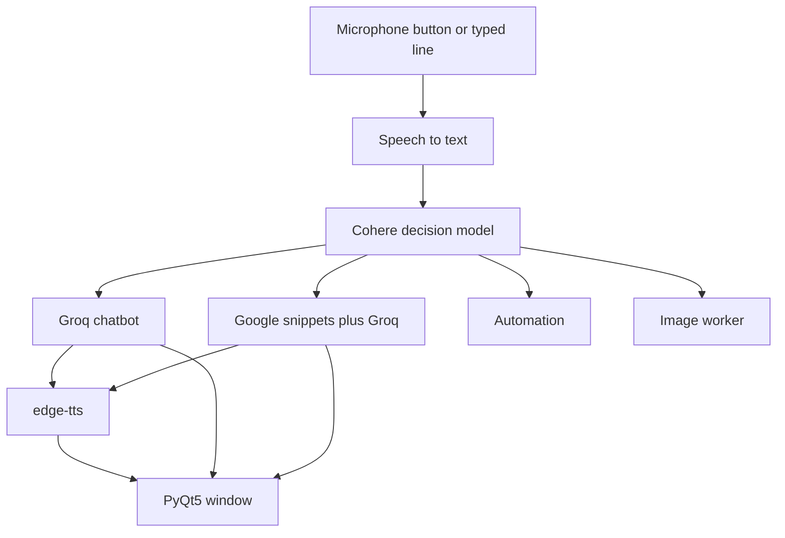

# DAVIAM

**Dynamic Automated Virtual Interactive Assistant Model**

A desktop assistant that listens, decides what you are asking for, and answers by voice. It can chat, look things up, open sites and applications, write a document, save a reminder, and generate images.


## Overview

DAVIAM is a Python desktop assistant. A PyQt5 window shows an animated home screen and a chat transcript. A background thread watches the microphone flag. When you turn the microphone on, the assistant hears a request (or reads a typed one), asks Cohere to classify it, and then calls the matching piece of the program: Groq for conversation, a web search for current questions, or a local action such as opening a site or generating images.

Speech is spoken back with Microsoft Edge voices through `edge-tts`. Long answers are shortened aloud and left in full on the chat screen.

The project is aimed at learning how speech, a decision model, and ordinary desktop tasks fit together. It is not a hosted product, and the repository does not currently include a licence file.

## Features

- **Voice in, voice out.** Chrome's Web Speech API captures speech. `edge-tts` speaks the reply. If Chrome or a microphone is not available, type the request instead.
- **Intent routing.** Cohere labels each request as chat, a live question, or a task: open, close, play, search, write, remind, change the volume, generate an image, or exit.
- **Conversation with memory.** General questions go to Groq. The exchange is stored in `DAVIAM/Data/ChatLog.json` and shown in the chat view.
- **Current answers.** Questions that need up-to-date information are grounded with Google result snippets plus today's date and time, then answered by Groq.
- **Desktop actions.** Open a known website or a local program, search Google or YouTube, play a YouTube result, or write text into a file and open it. A request to close Chrome is ignored, so speech recognition is not shut down by that command.
- **Reminders.** A reminder is appended to `DAVIAM/Data/Reminders.txt`. It is stored, not scheduled.
- **Images.** An image request produces up to four pictures with Stable Diffusion XL on Hugging Face and saves them under `DAVIAM/Data/`.
- **A small desktop window.** Home and Chat views, a microphone button, and minimise, restore, and close controls.

## Demo

A screen recording of the running window is not in the repository yet. The home screen plays this animation:


To add your own captures later, place them beside this file and embed them here, for example `docs/home.png` and `docs/chat.png`.

## Tech stack

| Piece | What it uses |
| --- | --- |
| Language | Python 3.10 or newer (developed and checked on 3.12) |
| Window | PyQt5 |
| Decisions | Cohere Chat API v2, default model `command-a-03-2025` |
| Chat, writing, and live answers | Groq, default model `openai/gpt-oss-120b` |
| Speech recognition | Selenium, Chrome, and the Web Speech API. Other languages are translated with `mtranslate` |
| Speech synthesis | `edge-tts` and `pygame` |
| Web search | `googlesearch-python` for snippets; the browser for a visible search |
| Images | Hugging Face Inference Providers, `stabilityai/stable-diffusion-xl-base-1.0` |
| Configuration | `python-dotenv` |

Both model ids can be changed in `.env` without editing code. The previous ids (`command-r-plus`, `llama3-70b-8192`, and `mixtral-8x7b-32768`) have been retired by their providers.

## Installation

You need Python 3.10+, pip, and an internet connection when you talk to the models. Voice input also needs Google Chrome. Image generation and chat need the API keys in the next section.

On Debian or Ubuntu, PyQt may also need:

```bash
sudo apt install libgl1 libglib2.0-0 libegl1 libxkbcommon0 libfontconfig1
```

Clone the repository, then from its root:

```bash
python -m venv .venv
source .venv/bin/activate          # Windows: .venv\Scripts\activate
python -m pip install -r requirements.txt
cp .env.example DAVIAM/.env
```

Edit `DAVIAM/.env` before the first launch. On Windows, if you want the original start-menu app launcher, also install `AppOpener` (`pip install AppOpener`). It does not run on Linux or macOS. Those systems use known website addresses and whatever programs are already on `PATH`.

## Configuration

Create `DAVIAM/.env` from `.env.example`. The file is ignored by git. Do not commit keys.

| Variable | Required | Purpose |
| --- | --- | --- |
| `Username` | No | Your name in the greeting and system prompt. Default: `User` |
| `Assistantname` | No | Name spoken in the interface. Default: `DAVIAM` |
| `FullForm` | No | Expansion of the name used in the system prompt |
| `InputLanguage` | No | Web Speech language tag, such as `en-US`, `en-GB`, or `hi-IN`. Default: `en-US`. Tags that do not start with `en` are translated to English before the models see them |
| `AssistantVoice` | No | An `edge-tts` short name. See `DAVIAM/Edge-tts Voices.txt`. Default: `en-US-JennyNeural`. British voices include `en-GB-RyanNeural` and `en-GB-SoniaNeural` |
| `GroqAPIKey` | Yes, for answers | Key from [Groq Console](https://console.groq.com/keys). Used for chat, document writing, and live answers |
| `CohereAPIKey` | Recommended | Key from [Cohere](https://dashboard.cohere.com/api-keys). Without it, every request is treated as general chat |
| `HuggingFaceAPIKey` | Yes, for images | Token from [Hugging Face settings](https://huggingface.co/settings/tokens), with permission to call Inference Providers |
| `GroqModel` | No | Overrides the Groq model id |
| `CohereModel` | No | Overrides the Cohere model id |
| `DAVIAM_SPEECH` | No | `auto` (default), `browser`, or `text` |
| `DAVIAM_HEADLESS` | No | Set to `1` to force text input and skip opening image viewers |

`auto` uses Chrome when a display is available. With no display, or when `DAVIAM_SPEECH=text`, type at the `You:` prompt, or write one line into `DAVIAM/Frontend/Files/Query.data` and turn the microphone on. The file is cleared once it has been read.

There is no sound card on some machines. DAVIAM still writes `DAVIAM/Data/speech.mp3` and does not crash. Playback uses a silent driver when `/dev/snd` is missing.

## Usage

From the repository root, with the virtual environment active:

```bash
python DAVIAM/Main.py
```

1. The home screen opens. The microphone starts off.
2. Click the microphone icon. The status line changes to `Listening...`.
3. Speak, or type if text mode is in use.
4. The reply appears in the window and is spoken when a speaker is available.
5. Use **Chat** on the top bar to read the transcript, and **Home** to return.
6. Saying goodbye is classified as `exit` and closes the program.

Examples of what the decision step is built to recognise:

- "How can I study more effectively?" → general chat
- "Who is the prime minister?" → a live search
- "Open YouTube" → the site in the browser
- "Play some jazz" → a YouTube result
- "Write a short note about the solar system" → a text file, then an editor
- "Set a reminder at 9pm to call home" → a line in `Reminders.txt`
- "Generate an image of a lighthouse" → up to four PNG files in `DAVIAM/Data/`
- "Turn the volume up" → the system volume, when the desktop allows it

Run the tests from the repository root:

```bash
pip install pytest
pytest
```

The tests do not call Groq, Cohere, or Hugging Face, and they do not need a microphone or speakers.

## Project structure

```
.
├── README.md
├── requirements.txt
├── .env.example
├── pytest.ini
└── DAVIAM/
    ├── Main.py                 # Window thread and assistant loop
    ├── paths.py                # Locations and .env loading
    ├── llm.py                  # Shared Groq client
    ├── textutil.py             # Question punctuation and blank-line cleanup
    ├── Edge-tts Voices.txt     # Voice names you can copy into .env
    ├── Backend/
    │   ├── Model.py            # Cohere decision step
    │   ├── Chatbot.py          # General conversation
    │   ├── RealtimeSearchEngine.py
    │   ├── Automation.py       # Open, search, write, volume, reminders
    │   ├── ImageGeneration.py  # Hugging Face image worker
    │   ├── SpeechToText.py
    │   └── TextToSpeech.py
    ├── Frontend/
    │   ├── GUI.py
    │   ├── Files/              # Microphone, status, and chat text shared with the GUI
    │   └── Graphics/           # Icons and the home animation
    ├── Data/                   # Chat log, speech file, reminders, generated images
    └── tests/
```

## How it works



`Main.py` starts two threads. One thread runs the PyQt window. The other waits until `Frontend/Files/Mic.data` is `True`, then handles a single request.

1. Speech recognition writes `Data/Voice.html` and reads the transcript from Chrome. Text mode never opens Chrome.
2. The transcript is normalised (a question mark or a full stop, then a capital letter). Non-English input is translated first.
3. Cohere returns one or more labels, such as `general ...` or `open youtube`. If the key is missing or the reply cannot be parsed, the request is treated as general chat.
4. Task labels are carried out together. A general question and a live question in the same utterance are merged and answered from search results. Otherwise a general question goes to the chatbot and a live question goes to the search engine.
5. An image label is written to `Frontend/Files/ImageGeneration.data`. A separate Python process generates the files and then exits.
6. The answer is written to `Frontend/Files/Responses.data`, which the window polls, and passed to `edge-tts`. Replies with more than four sentences and at least 250 characters are spoken only in part. The rest stays on screen.
7. The microphone flag returns the loop to `Available ...` until the next click.

The window, the listener, and the image worker share plain text files rather than a network socket. That keeps the pieces independent, and it is also why those files must stay next to the code. Paths are resolved from the location of the package, so the working directory does not matter.

## Roadmap

These are not implemented. They are reasonable next steps:

- Pop a reminder at the time that was asked for, instead of only appending it to a file
- Wire up the unused settings graphic as a real settings screen for voice, language, and keys
- A wake word, so the microphone does not have to be clicked
- Speech recognition that does not depend on Chrome
- Continuous conversation without toggling the microphone for every turn
- A proper open-source licence, once the author chooses one
- Screenshots and a short demo video in `docs/`
- A continuous-integration run of `pytest`

## Contributing

Issues and pull requests are welcome.

1. Fork the repository and branch from `main`.
2. Keep secrets out of the diff. `.env` is gitignored. Update `.env.example` if you add a variable.
3. Prefer a failing test in `DAVIAM/tests/` for a bug fix, then run `pytest`.
4. Do not commit `__pycache__/`, generated speech, or API keys.

If you change a model id, check the provider's current model list first. Both Groq and Cohere retire ids.

## Author

**Mohammad Azhan Naseem**

Computer Science and AI student.

GitHub: [@Azhassin](https://github.com/Azhassin)

## Licence

This repository does not include a licence file. The project was written for education and demonstration. Ask the author before you reuse the code in another product.
